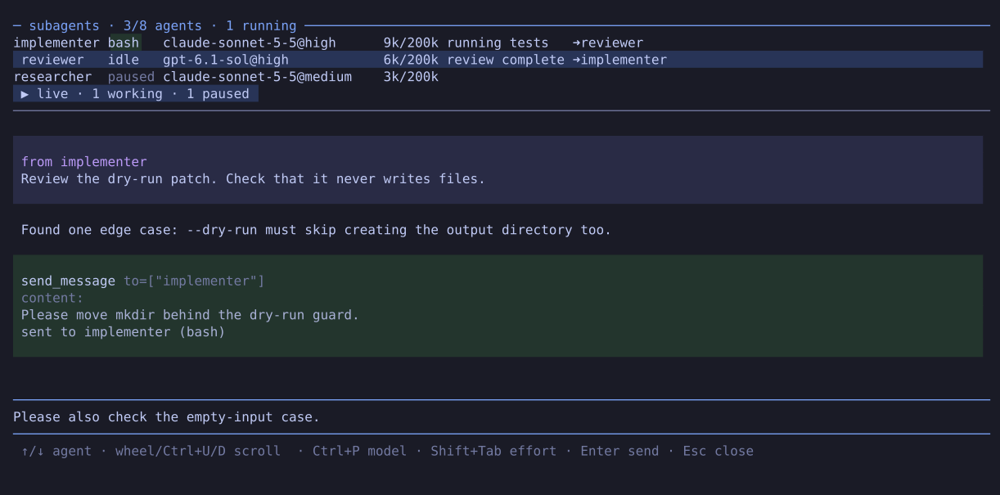

# pi-actor-subagents

Build arbitrary agent hierarchies in [Pi](https://pi.dev/) where every agent can message every other agent. Inspect their conversations and steer them directly. Agents survive Pi restarts.

Pairs well with [pi-infinite-context](https://github.com/fdietze/pi-infinite-context) for long-running conversations.

## Install

```bash
pi install npm:pi-actor-subagents
```

## Subagents panel



Select an agent to inspect its conversation and message it directly.

## Tools

| Tool | Purpose |
|---|---|
| `spawn_subagent` | Create a named agent with its own system prompt, initial task, model, and session. |
| `send_message` | Send a message to one or more agents, including parents, children, and peers. |
| `list_subagents`, `subagent_history` | Inspect agent state and conversations. |
| `set_subagent_model`, `set_status` | Change model or thinking level; report progress and ETA. |
| `pause_subagents`, `resume_subagents`, `kill_subagents` | Control owned agents and their descendants. |

`/subagents` opens the panel. `/subagents-pause`, `/subagents-resume`, and `/subagents-kill` control named subtrees; omit names to target your direct children.

All tool results in the main session and subagents include start/finish timestamps, giving agents a sense of elapsed time for progress updates and ETA estimates. If a start time is unavailable, only the finish time is shown.

## Configuration

Optional file: `~/.pi/agent/actor-subagents/settings.json` (inside Pi's configured agent directory):

```json
{
  "maxAgents": 8,
  "maxSpawnDepth": 3,
  "childExtensions": [
    "~/.pi/agent/npm/node_modules/pi-infinite-context/extensions/infinite-context/index.ts"
  ]
}
```

- `maxAgents`: maximum live background agents (default: `8`).
- `maxSpawnDepth`: maximum hierarchy depth (default: `3`). Both limits must be positive integers; missing or invalid values use their defaults. Changes apply after restarting Pi.
- `childExtensions`: extension whitelist for subagents (default: `[]`). List extension files or directories; children do not inherit Pi's discovered extensions. Actor-subagents' orchestration tools are always available and need no whitelist entry. Changes apply to newly spawned agents. The example path assumes `pi install npm:pi-infinite-context` in the default Pi setup.

## Coordination

- **Handshake:** a new child is instructed to send its parent its understanding of the task and clarification questions, then wait for a `send_message` go-ahead before working. This is an agent protocol, not an enforced scheduling barrier.
- **Ownership:** every agent controls the agents it spawns and their descendants; messaging and inspection are open to all. `set_status` is for background agents.
- **Persistence:** reopening the same saved main session restores agents paused; resume them explicitly. Buffered messages, progress, and ETA are not saved.
